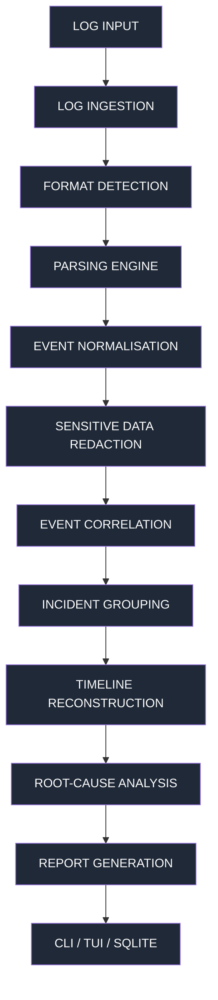

# TraceBack Architecture

## Overview

TraceBack is a local-first developer debugging utility that analyses application
logs, correlates related events, reconstructs chronological incident timelines,
and identifies likely failure points.

The core analysis engine is completely independent of the CLI and TUI layers,
making it reusable through both interfaces.

## Processing Pipeline



### Pipeline Stages

1. **Log Ingestion** — Reads files/directories using streaming where possible
2. **Format Detection** — Auto-detects JSON, JSONL, text, Python tracebacks, Node.js traces
3. **Parsing Engine** — Format-specific parsers extract raw log records
4. **Event Normalisation** — Converts records to the common `Event` Pydantic model
5. **Sensitive Data Redaction** — Replaces secrets with `[REDACTED]` before any processing
6. **Event Correlation** — Groups events by request ID, trace ID, session ID, timestamp proximity
7. **Incident Grouping** — Combines correlated events into `Incident` groups
8. **Timeline Reconstruction** — Sorts events chronologically, flags anomalies
9. **Root-Cause Analysis** — Rule-based detection of failure patterns (null ref, DB timeout, etc.)
10. **Report Generation** — Produces Markdown and JSON reports

## Module Structure

```
src/tb_core/
├── __init__.py
├── main.py                 # Typer CLI entry point
├── cli/                    # CLI commands (typer)
├── tui/                    # Textual TUI (dashboard, incidents, timeline, investigation)
├── ingestion/              # Log loading, format detection, parsing
│   ├── loader.py           # File/directory loading with streaming
│   ├── detector.py         # Auto format detection
│   ├── json_parser.py      # JSON log parsing
│   ├── jsonl_parser.py     # JSONL parsing
│   ├── text_parser.py      # Plain-text log parsing
│   ├── python_parser.py    # Python stack trace parsing
│   └── node_parser.py      # Node.js stack trace parsing
├── core/                   # Core analysis engine
│   ├── models.py           # Pydantic models (Event, Incident, Evidence)
│   ├── normalizer.py       # Timestamp/level/service normalisation
│   ├── correlator.py       # Event correlation engine
│   ├── timeline.py         # Timeline reconstruction
│   └── incident.py         # Incident grouping
├── analysis/               # Deterministic analysis
│   ├── rules.py            # Rule-based pattern detection
│   ├── root_cause.py       # Root-cause analysis
│   ├── cascade.py          # Cascading error detection
│   └── recommendations.py  # Debugging step suggestions
├── security/               # Secret redaction
│   └── redactor.py         # API keys, JWT, passwords, etc.
├── storage/                # SQLite persistence
│   └── database.py         # Incident history storage
├── reporting/              # Report generation
│   ├── markdown.py         # Markdown report writer
│   └── json_report.py      # JSON report writer
└── utils/                  # Utilities
    ├── timestamps.py       # Timestamp formatting/parsing
    └── helpers.py          # General helpers
```

## Data Models

### Event

Each normalised log record:
- `event_id` — Unique identifier
- `timestamp` — Timezone-aware datetime
- `level` — DEBUG/INFO/WARNING/ERROR/CRITICAL
- `message` — Log message text
- `service` — Service name (optional)
- `request_id` — Request identifier (optional)
- `trace_id` — Distributed trace identifier (optional)
- `session_id` — Session identifier (optional)
- `source_file` — Original log filename
- `line_number` — Line in original file
- `exception_type` — Exception class name
- `stack_trace` — Full stack trace text
- `metadata` — Additional key-value data

### Incident

Each grouped incident:
- `incident_id` — Unique incident identifier (TB-XXXX)
- `title` — Human-readable title
- `severity` — DEBUG/INFO/WARNING/ERROR/CRITICAL
- `start_time` / `end_time` — Time range
- `primary_error` — Main error message
- `related_events` — List of Event objects
- `request_id` / `trace_id` — Correlation identifiers
- `affected_services` — List of service names
- `suspected_failure_points` — Likely failure locations
- `possible_root_causes` — Hypothesised root causes
- `recommendations` — Debugging steps
- `confidence` — HIGH/MEDIUM/LOW
- `evidence` — List of Evidence objects
- `analysis_metadata` — Additional metadata

### Evidence

Each finding:
- `finding` — Description
- `event_ids` — Supporting event IDs
- `source_file` — Source filename
- `line_number` — Original line number
- `confidence` — HIGH/MEDIUM/LOW
- `is_observed` — Observed fact vs inferred hypothesis

## Technology Stack

| Layer | Technology |
|-------|-----------|
| Language | Python 3.12+ |
| CLI | Typer |
| TUI | Textual |
| Styling | Rich |
| Data validation | Pydantic v2 |
| Database | SQLite (sqlite3) |
| Testing | Pytest |
| Packaging | pyproject.toml, uv |

## Key Design Decisions

- **Local-first**: No cloud dependencies, no mandatory API keys
- **Deterministic**: All correlation and root-cause analysis is rule-based
- **Optional AI**: LLM integration only for explaining evidence, never for core logic
- **Secret redaction**: All secrets redacted before any processing or export
- **No data fabrication**: Missing fields are never invented; `None` is preserved
- **Streaming ingestion**: Large files are processed line-by-line

## Testing

Run the test suite:

```bash
uv run pytest tests/
```

Or:

```bash
pip install -e .
pytest tests/
```

Test coverage includes: parsers, normalizer, correlator, timeline, analysis, redactor, reporting.
